# Kids Playhouse

A plan for a 120 × 120 cm wooden kids playhouse with an enclosed room, a serving window with a counter, a railed front porch and a gable roof.

| | |
|---|---|
| Footprint | 120 × 120 cm deck |
| Room | 120 × 80 cm, walls 90 cm high |
| Porch | 120 × 40 cm, railings 50 cm high on the front and both sides, 50 cm opening |
| Roof | gable, apex 120 cm above the deck, 10 cm overhang |
| Serving window | 45 × 35 cm on the left side wall, sill and counter at 55 cm |
| Door | 40 × 75 cm |

## Build guide

**[Open the build guide online](https://vgdagpin.github.io/kids-house/build-guide)**

It has the dimensions, materials, cut list and tools, then ten illustrated build steps for the base, walls, porch pillars, roof and railings, and a safety checklist.

You can also open [build-guide.html](build-guide.html) directly in a browser, or print [build-guide.pdf](build-guide.pdf).
